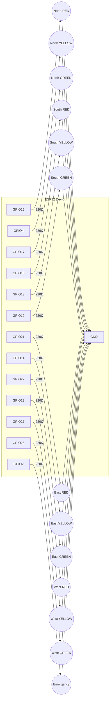
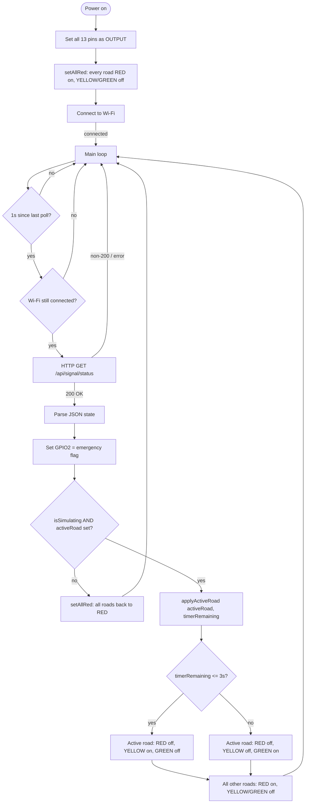

# ESP32 Smart Traffic Light — Wiring & Logic

Drives 4 roads x (1 red LED + 1 yellow LED + 1 green LED) plus 1 emergency
indicator LED, all as **separate, individual LEDs** (no relay module / no
pre-built signal head) — each wired straight off a GPIO through its own
resistor.

## Pin map

| Road  | LED colour | ESP32 GPIO | Notes |
|-------|-----------|------------|-------|
| North | Red       | GPIO16     | UART2 RX — fine to reuse as GPIO here |
| North | Yellow    | GPIO4      | |
| North | Green     | GPIO17     | UART2 TX — fine to reuse as GPIO here |
| South | Red       | GPIO18     | |
| South | Yellow    | GPIO13     | |
| South | Green     | GPIO19     | |
| East  | Red       | GPIO21     | Default I2C SDA — fine if I2C unused |
| East  | Yellow    | GPIO14     | |
| East  | Green     | GPIO22     | Default I2C SCL — fine if I2C unused |
| West  | Red       | GPIO23     | |
| West  | Yellow    | GPIO27     | |
| West  | Green     | GPIO25     | DAC-capable pin, works fine as digital out |
| —     | Emergency | GPIO2      | Often shared with the onboard blue LED |
| —     | (common)  | **GND**    | Any GND pin — all LED cathodes return here |

All 13 pins are safe general-purpose outputs on a standard ESP32 DevKit
(WROOM-32). Avoid input-only pins (GPIO34–39) and the strapping pins
(GPIO0, 5, 12, 15) if you re-map anything — GPIO2 is used here only for a
low-priority indicator, which is safe.

## Per-LED wiring

```
ESP32 GPIO ──/\/\/\── LED anode (+, long leg)
 (e.g. 16)   220-330Ω        │
                          LED cathode (-, short leg)
                              │
                             GND ── ESP32 GND
```

Repeat this for all 13 LEDs (12 road LEDs + 1 emergency LED), each with its
own resistor, all cathodes returning to any ESP32 GND pin.

## Full wiring diagram



## Program flow



## Notes

- Each LED needs its **own** resistor (don't share one resistor across
  multiple LEDs) — 220–330Ω is a safe range for standard 5mm LEDs at 3.3V
  GPIO output.
- Mind LED polarity: the longer leg (anode) goes toward the resistor/GPIO
  side, the shorter leg (cathode) goes to GND.
- The yellow LED only lights up for the active road, during the last
  `YELLOW_WARNING_SECONDS` (3s by default) of its green window, before that
  road switches to red — this mirrors real traffic lights. Non-active roads
  stay solid red the whole time; there's no backend "yellow" state, it's
  derived on-device from `timerRemaining`.
- `SERVER_HOST` in the `.ino` must match the backend PC's current Wi-Fi LAN
  IP (`ipconfig` on Windows) — it changes if the PC reconnects to Wi-Fi.
